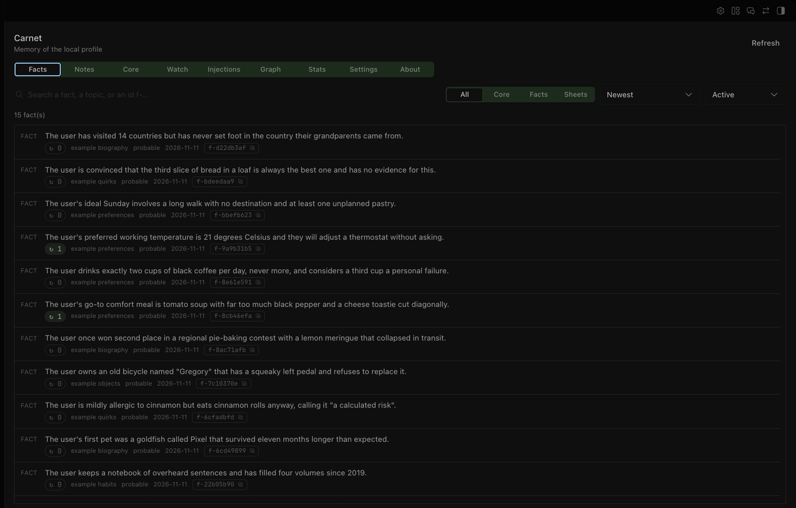
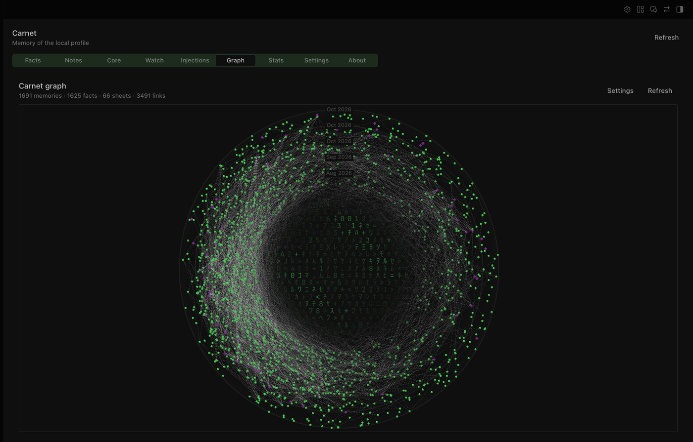
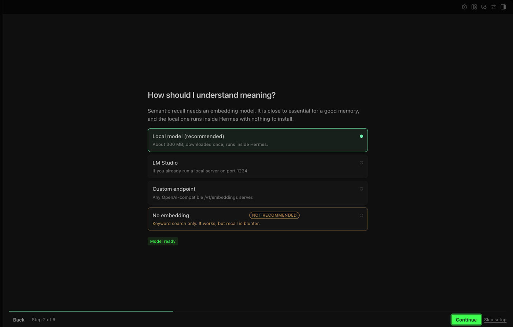

# Carnet

**Memory that grows without growing your context.**

Carnet is a memory plugin for [Hermes Agent](https://hermes-agent.nousresearch.com).
The point is not that it stores a lot: it is that the block injected into the
prompt is capped, so turn 900 costs about what turn 9 cost. One SQLite file, no
server, no API key, and a memory graph inside the app.

`MIT` · `Hermes >= 0.23` · `Python 3.11+` · `macOS, Linux`

---

## The problem

Most memory plugins either keep everything and reinject it on every turn, until
the context and the bill grow faster than the usefulness, or they hand your life
to a hosted service that needs an account and a key. Both trade the same thing:
you pay every turn for facts you do not need right now.

Carnet was written after trying those. Memory should cost about the same whether
it holds two hundred facts or twenty thousand, and it should be possible to
point at one fact, read it, correct it, and forget it.

## What makes it different

- **Bounded context.** The injected block has a character budget it cannot
  exceed, notes and status line included. The memory can grow for months while
  the context stays flat, and the ceiling is a number you set, not a hope.
- **Four layers, one of them small on purpose.** A core of 20 seats always in
  the prompt, facts recalled only when the turn makes them relevant, sheets read
  on demand, notes that expire by themselves. Promotion into the core is a
  decision, not an accident.
- **Native to Hermes.** A real page in the desktop app, a real memory provider in
  the agent. No browser tab, no companion service, no scraping.
- **Lightweight.** The hot path is the Python standard library and one SQLite
  file. No vector database, no daemon required to start.
- **Nearly unlimited.** Facts cost nothing while they sit still. They are read
  only when the conversation makes them relevant.
- **Precise.** Every fact has an id, a confidence, a date, a source. Each one is
  addressable: correct it, promote it, remove it, one by one.
- **Local.** Everything lives in `$HERMES_HOME/carnet/`. Nothing leaves the
  machine unless you point an embedding endpoint somewhere else.

---

## Install

### 1. Ask your agent

Paste this into a Hermes session:

> Install the Carnet memory plugin from https://github.com/404BugX/carnet :
> clone it to `~/.hermes/plugins/carnet`, copy `desktop/plugin.js` to
> `~/.hermes/desktop-plugins/carnet/plugin.js`, enable the plugin, and set
> `memory.provider` to `carnet`.

The agent runs these commands for you and tells you when to restart.

### 2. From a terminal

```bash
git clone https://github.com/404BugX/carnet ~/.hermes/plugins/carnet
mkdir -p ~/.hermes/desktop-plugins/carnet
cp ~/.hermes/plugins/carnet/desktop/plugin.js ~/.hermes/desktop-plugins/carnet/
hermes plugins enable carnet
hermes config set memory.provider carnet
```

Restart Hermes. The first time you open the **Carnet** page, a short guided
setup asks four questions: interface language, embedding backend, rewrite model,
and temporary notes. Every answer stays editable later.

### 3. From the catalog

Once the plugin is listed:

```bash
hermes plugins install carnet
```

---

## The interface

The page lives in the sidebar, next to Sessions and Capabilities.



The graph is drawn with the app's own theme variables, not a bolted-on widget:
concentric rings walk from the oldest memories to the newest, links join facts
that are semantically close, and each topic gets its own cluster.



Same settings screen for everything that matters, and a guided setup on first
run:



---

## The four layers

| Layer | What it holds | When it is read | What it costs |
|---|---|---|---|
| **Core** | The short rules that must always be in mind | Every turn, in the system prompt | 250 chars × seats (20 by default) |
| **Facts** | Preferences, decisions, constraints, small events | Only when the turn makes them relevant | Capped per turn |
| **Sheets** | Long documents: procedures, dossiers, protocols | An excerpt on demand, the rest via `read_fiche` | 400 chars per sheet, once |
| **Notes** | Short-lived reminders that expire on their own | First turn of the next session | Off by default, 300 chars each |

A fact is one self-contained sentence about one thing. A sheet is a document.
The distinction is what keeps retrieval honest: a 4000 character procedure never
competes with a 90 character preference for the same slot.

---

## What the model actually receives

At the start of a session, the core is injected as a short block:

```
[MEMORY - permanent core, 12/20 seats · 431 facts · 6 sheets, as of 2026-11-10]
· The build uses a local SQLite file, never a remote server.
· Preference: answers in French, short, verdict first.
Markers in what follows: ✓ certain · ✓? certain but without evidence · ~ probable
· [0] core seat, [1] fact, [2] sheet · each line ends with its id, usable with
`forget` and `read_fiche`. A score in `recall` is the share of your query terms
the fact contains, not a confidence in the answer.
```

Then, per turn, only what is both unseen in this session and relevant:

```
[memory · 3 new · 12 already in context]
[1] ✓ 2026-11-02 · f-8c41aa02 · The launcher starts in AppTranslocation when unsigned.
[1] ~ 2026-11-04 · f-1d90c7e4 · Builds take about six minutes on four cores.
```

### The recall contract

`recall` returns a score that means one thing: **the share of your own query
words the fact contains**. It is not a similarity and not a confidence.

- `1.0` means every word you asked for is in the fact.
- `weak: true` means less than half of them are, so the answer may be unrelated.
- Below `recall_floor` (0.34 by default) there is no result at all: the tool
  answers `nothing relevant` with the measured coverage, instead of returning
  noise with a reassuring number.

A memory that says "I know nothing about this" is more useful than one that
answers with its best guess.

---

## Settings

| Setting | Default | Meaning |
|---|---|---|
| `seat_limit` | 20 | Number of core rules kept in the system prompt |
| `seat_char_limit` | 250 | Maximum characters per core rule |
| `fact_char_limit` | 500 | Maximum characters per fact (longer ones are refused) |
| `max_facts_per_turn` | 8 | Facts injected at most per turn |
| `max_sheets_per_turn` | 2 | Sheets injected at most per turn |
| `budget_chars_turn` | 1400 | Hard cap of the injected block per turn |
| `budget_chars_first_turn` | 4000 | Same, on the first turn of a session |
| `abstention_threshold` | 0.55 | Below this relevance, a fact is not injected |
| `recall_floor` | 0.34 | Below this coverage, `recall` answers "nothing relevant" |
| `notes_enabled` | `false` | Temporary notes layer |
| `max_notes` / `expiry_days` | 8 / 7 | Active notes and their lifetime |
| `embed_backend` | `lmstudio` | `disabled`, `lmstudio`, `sidecar` (the page calls it *local*), `custom` |
| `model_mode` | `off` | Optional small model that rewrites facts more cleanly |

All of them are in the app, under Carnet > Settings, and in
`$HERMES_HOME/carnet/config.json`.

---

## Embedding backends

Semantic recall is optional. The plugin works without it, on keywords only.

| Backend | What it needs | Notes |
|---|---|---|
| `disabled` | Nothing | Keyword search. Fast to start, blunter recall. |
| `lmstudio` | LM Studio running locally | Uses `/v1/embeddings` on `127.0.0.1:1234`. |
| `local` | A one-time 300 MB download | Runs inside Hermes, no external server. |
| `custom` | Any OpenAI-compatible endpoint | URL, model and optional key. |

The local model is `embeddinggemma-300m` in ONNX form. It is downloaded only
when you ask for it, from Hugging Face, into a cache shared by every profile.

---

## Privacy and disclosures

Everything a user should know before installing:

- **No telemetry.** The plugin reports nothing, anywhere.
- **No network call by default.** Requests go to `127.0.0.1` (LM Studio), to an
  endpoint you typed yourself, or to Hugging Face when you press *Download the
  model*. Nothing else.
- **One background process, only in `local` mode.** A Python sidecar holds the
  ONNX model in memory, is shared by every session, and is released after 30
  minutes of inactivity or when the machine runs short on memory.
- **Credentials through Hermes.** Two secrets at most: `CARNET_EMBED_API_KEY` and
  `CARNET_MODEL_API_KEY`, both declared in the manifest and read with
  `agent.secret_scope`, so a key never leaks across profiles and is never written
  to a config file.
- **What the plugin reads.** Its own data lives in `$HERMES_HOME/carnet/`; it also
  reads `$HERMES_HOME/config/carnet.json` (shared settings), the shared model
  cache under `$HERMES_HOME/cache/carnet/` when the local backend is on, and the
  profile's `config.yaml` to follow the interface language. Nothing else.
- **The memory is yours to read.** The memory is one SQLite file; `sqlite3 carnet.db` works.

---

## Several profiles

The code and the embedding model are shared by the whole Hermes installation;
the memory is not. Each profile has its own database at
`$HERMES_HOME/carnet/carnet.db`.

Each profile installs the plugin itself:

```bash
hermes -p <profile> plugins install 404BugX/carnet
```

Creating a profile by copying your home copies the database with it. Carnet
detects that case, on the first start of the new profile, and sets the copied
database aside as `carnet-<timestamp>.db`, so a new agent does not answer with
someone else's memories and nothing is destroyed if the guess was wrong. A
profile that was *moved* keeps its memory: the check looks at whether the
original home still exists, and compares resolved paths, so the same home opened
through a symlink is not mistaken for a move.

---

## How it works

```
plugin.yaml          manifest: tools, hooks, compatibility
provider.py          the MemoryProvider: injection, tools, budgets
store.py             SQLite: schema, migrations, search, notes
embedder.py          optional vectors: four backends, keep-alive
rephrase.py          optional small model that tidies a fact
watch.py             background pass over the session queue
dashboard/           the page's HTTP layer
desktop/plugin.js    the page itself, on the Desktop plugin SDK
locales/             en, fr
tests/               behavioural tests, standard library only
```

Nothing patches Hermes. The plugin uses the public `MemoryProvider` API and the
Desktop plugin SDK, which is also what makes it survive a Hermes update.

---

## Development

```bash
python3 -m unittest discover -s tests
```

The suite needs no network and no model, and it never touches your real home: it
covers the schema migrations, the note lifecycle, the clone check that sets a
copied database aside, and the meaning of the score `recall` reports. One of its
module imports Hermes' provider base, so run it from a Hermes checkout or point
`CARNET_HERMES_AGENT` at one; they skip themselves otherwise.

---

## License

MIT. See [LICENSE](LICENSE).
